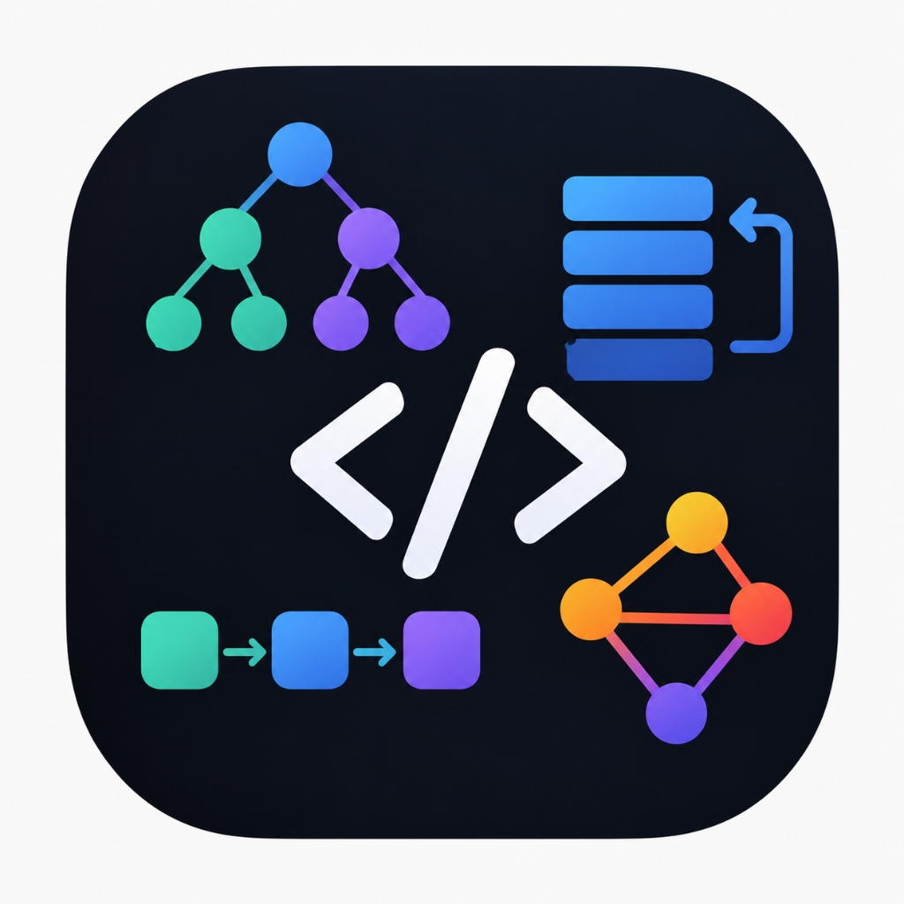

# 🚀 DSA Tracker Pro

> A modern, full-fledged web application to track, practice, compile, and revise 448+ curated Data Structures & Algorithms problems.



---

## 🌟 Key Features

* **448 Curated Problems**: Love Babbar & Top Tech interview problems categorized by topics (Arrays, Strings, Linked Lists, Binary Trees, Graphs, DP, etc.).
* **Real-time Search & Multi-Filters**: Filter by title, topic, status (Solved, Unsolved, Starred ⭐), difficulty (Easy, Medium, Hard), and company tags (Google, Amazon, Meta, etc.).
* **In-Browser Code Compiler**:
  * Instant client-side JavaScript execution with sandboxed console output.
  * Multi-language support (C++, Python, Java, Go, Rust, TypeScript) via Piston API.
  * Test case runner with custom stdin input, expected output, and automatic pass/fail checks.
  * **Big-O Algorithmic Complexity Analyzer**: Heuristic evaluation of time and space complexity.
* **Scientific Spaced Repetition**:
  * Revision scheduler across 5 intervals (**Day 1, 3, 7, 15, and 30**) with due and overdue counters.
* **Gamified Dashboard & Heatmap**:
  * GitHub-style annual solve activity heatmap.
  * Sequential DSA Journey Roadmap stations.
  * Day streak tracking with milestone badges (🥉 Bronze, 🥈 Silver, 🥇 Gold, 💎 Diamond, 👑 Master).
* **Google Authentication & Cloud Storage**:
  * Sign in with Google to sync progress across all devices via Firebase & Firestore.
* **Aesthetic Light & Dark Modes**:
  * Seamless one-click mode switcher with custom dynamic logos for each mode.
* **Synthesized Audio & Celebrations**:
  * Web Audio API synthesized solve chimes, streak fire whoosh sounds, and confetti bursts.

---

## 🛠️ Tech Stack

* **Framework**: React 19 + Vite
* **Language**: TypeScript
* **Styling**: Tailwind CSS
* **Icons**: Lucide Icons
* **Database & Auth**: Firebase Auth (Google Provider) + Cloud Firestore
* **Animations**: Canvas Confetti
* **Audio**: Native Web Audio API

---

## 🚀 Getting Started

### Prerequisites

* Node.js (v18 or higher)
* npm / yarn / pnpm

### Installation

1. Clone the repository:
   ```bash
   git clone https://github.com/harshitsinghgaharwar77-art/dsa-tracker-pro.git
   cd dsa-tracker-pro
   ```

2. Install dependencies:
   ```bash
   npm install
   ```

3. Run the development server:
   ```bash
   npm run dev
   ```

4. Build for production:
   ```bash
   npm run build
   ```

---

## ☁️ Firebase Cloud Sync Setup (Optional)

To enable cross-device progress synchronization:
1. Create a free project at [Firebase Console](https://console.firebase.google.com).
2. Enable **Authentication** with **Google** provider.
3. Enable **Cloud Firestore** in production mode.
4. Copy your web app config and paste it into the Cloud Sync setup modal in the app or into `firebase-config.js`.

---

## 📄 License

MIT License. Built with ❤️ for DSA learners.
